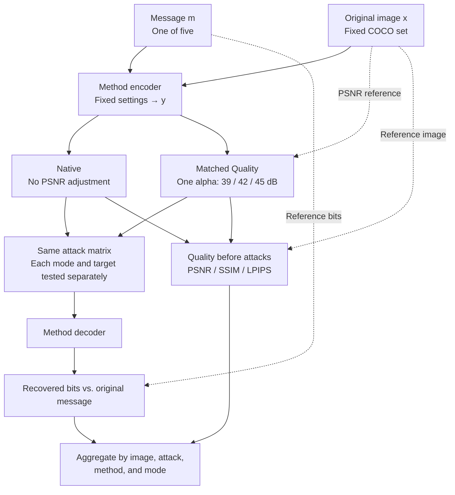

# Digital channel protocol

This protocol tests watermark recovery after digital image distortions. It uses two embedding modes: Native and Matched Quality. Neural editing and physical capture are separate experiments.

## 1. Images and messages

All methods use the same fixed set of N COCO images, prepared as 512 × 512 RGB PNG files. The image IDs and preprocessing settings are stored in the dataset manifest.

Each image is tested with five fixed 30-bit messages. The same messages are used across methods and modes. This gives:

- N × 5 image–message pairs per method in Native mode;
- N × 5 pairs per method **at each PSNR target** in Matched Quality mode.

For methods with a payload longer than 30 bits, the common evaluation uses the **last 30 bits**. The remaining positions follow a fixed, recorded filling rule. Full payload length and full-message errors are reported separately.

This aligns the evaluated message segment, not the total embedded payload. It is not an equal-capacity comparison.

The digital test set comprises TrustMark-Q, WAM, VideoSeal, PixelSeal, ChunkySeal, VINE-B, VINE-R, RoSteALS, InvisMark, RivaGAN benchmark, DWT-DCT-SVD, MBRS, CIN, HiDDeN benchmark, and EditGuard. The run manifest identifies the implementation, checkpoint, numerical precision, and embedding settings for each method. Benchmark variants are kept distinct from the original authors' checkpoints.

## 2. Embedding modes

### Native

- Embed with the fixed settings chosen for each method.
- Do not adjust PSNR.
- Clip and round the output to an 8-bit image, then measure its actual quality.

This mode measures robustness at the selected native configuration and the image distortion that comes with it.

### Matched Quality

The targets are **39, 42, and 45 dB**, measured against the original image **before any attack**. The tolerance is **±0.05 dB**.

For the original image x and encoder output y, scale the embedding residual using one coefficient for the whole image:

$$
y_\alpha = Q\left(\operatorname{clip}\left(x + \alpha(y-x),\,0,\,1\right)\right).
$$

Here, Q rounds to the 8-bit grid. A coefficient above 1 strengthens the residual; a coefficient between 0 and 1 weakens it. PSNR is calculated after clipping and rounding.

The search uses PSNR only, with no decoder feedback. **No pixel-wise correction or mixing of neighbouring candidate images is allowed.** The alpha bounds, search procedure, and stopping rule must be fixed for all methods and recorded before the full run.

For every pair and target, save alpha, achieved PSNR, and matching status. If the search does not find a value within tolerance, retain the diagnostic record but do not label the image as matched. Search failure is not, by itself, proof that the target is mathematically unattainable.

If PSNR matches but the watermark no longer decodes, this is a valid robustness result, not a matching failure.

Matched Quality compares robustness at similar pixel distortion. It does not guarantee equal perceptual quality; SSIM and LPIPS are reported alongside PSNR.

Encoder settings are applied before embedding. Quality matching is applied after embedding and before attacks. The decoder is unchanged between modes.

## 3. Pipeline

Attack, decoding, and evaluation stages are shared by both modes. Each attack starts from the pre-attack marked image, not from the output of the previous attack. Only the compound attack uses a sequence of transformations.

## 4. Distortions and attacks

| Condition | Parameters | Repeats per level |
|---|---|---:|
| Clean | No distortion | 1 |
| JPEG | Quality: 90, 70, 50, 30 | 1 |
| Gaussian noise | Sigma: 0.005, 0.01, 0.02, 0.04; pixel range [0, 1] | 5 |
| Gaussian blur | Sigma: 0.5, 1, 1.5, 2 pixels | 1 |
| Brightness | Multiplier: 0.70, 0.85, 1.15, 1.30 | 1 |
| Crop → resize | Retain 90%, 75%, or 50% of the **area** at a random location; restore original dimensions | 5 |
| Resize → restore | Side-length scale: 0.75, 0.50, 0.25; restore original dimensions | 1 |
| Rotation | −15°, −10°, −5°, −2°, +2°, +5°, +10°, +15° | 1 |
| Compound attack | Four levels below | 5 |

Random seeds and sampled transformation parameters are shared across the compared methods and modes. Interpolation, padding, and clipping settings are fixed in the attack configuration.

The compound attack applies **brightness → rotation → resize and restore → Gaussian noise → JPEG**, in that order.

| Level | Brightness range | Rotation range | Scale | Noise sigma | JPEG quality |
|---|---|---|---:|---:|---:|
| 1 | 0.90–1.10 | ±2° | 0.90 | 0.005 | 90 |
| 2 | 0.85–1.15 | ±5° | 0.75 | 0.010 | 70 |
| 3 | 0.75–1.25 | ±10° | 0.50 | 0.020 | 50 |
| 4 | 0.60–1.40 | ±15° | 0.25 | 0.040 | 30 |

There are **79 conditions**, including random repeats and Clean, per image–message pair for one mode configuration.

## 5. Metrics

| Quantity | Measurement |
|---|---|
| Message errors | BER over the common 30-bit segment |
| Bit accuracy | 1 − BER |
| Exact recovery | Fraction of messages with all 30 bits recovered correctly |
| Full payload | Payload length and full-message errors, separate from the common-segment results |
| Embedding quality | PSNR, SSIM, and LPIPS between the original and marked image **before attacks** |
| Computational cost | Embedding and extraction time, with hardware and execution settings |
| Quality matching | Fraction within tolerance, achieved PSNR, alpha, and failure reason |

Watermark detection and message recovery are different tasks. A claim of TPR at a given FPR requires separate evaluation on unwatermarked images. A theoretical random-guessing threshold is not an empirical FPR measurement.

## 6. Aggregation and comparison

- Average messages and random repeats within each image, then average across images.
- Report each attack family and severity separately.
- For the overall robustness score, average levels within each family and give the eight attack families equal weight. Report Clean separately, outside this score.
- Use image-level bootstrap sampling with 2,000 resamples to obtain 95% confidence intervals. Messages and attack repeats are not treated as independent images.
- Keep Native and the three Matched Quality targets in separate tables.
- Report matching coverage for every method and target. Pairwise matched-quality comparisons use common image–message pairs that meet the target for both methods, with the comparison sample size stated. Do not silently drop unmatched cases or compare averages drawn from different subsets as if they were paired.

Native answers: how robust is the method at its selected embedding settings? Matched Quality answers: how robust is it at the specified PSNR?

## 7. Scope of this version

This is the specification for the next digital run, not a claim that every requirement has already been implemented or verified. The run configuration must fix the remaining implementation details before execution.

Earlier digital code allowed a pixel-wise fallback when scalar PSNR matching failed. Those runs must retain their original protocol description unless their records confirm that the fallback was unused. This version uses scalar matching only; adopting it does not retrospectively change earlier results.
