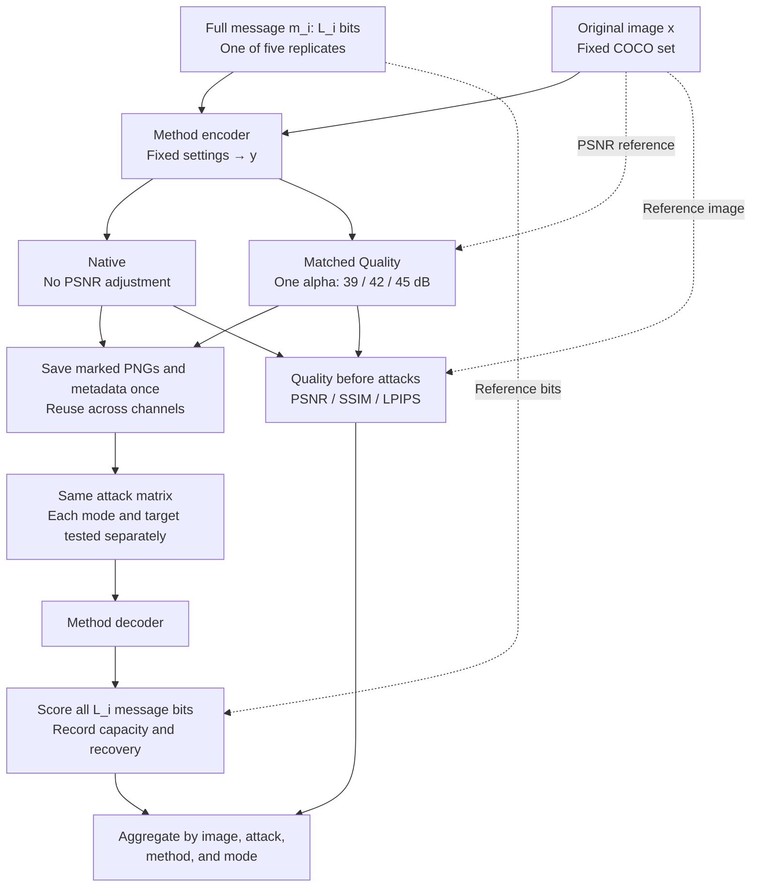

# Digital channel protocol

This protocol tests watermark recovery after digital image distortions. It uses two embedding modes: Native and Matched Quality. Neural editing and physical capture are separate experiments.

**Payload policy: full native payload, revision 21 September 2026.** The three channel protocols use one shared embedding bank. The earlier common-30-bit evaluation is not the policy for this run.

**Method update, 29 September 2026:** replace the old HiDDeN benchmark entry with [Meta Revisited HiDDeN](meta-hidden-revisited.md). Its fixed profile uses all 48 bits and a central 256×256 crop of the frozen RGB512 source, without resizing. Measure embedding quality and perform scalar matching against that crop. Reuse the same saved carrier across channels; do not merge old HiDDeN measurements into the Meta row. The scope remains 32 entries.

## 1. Images and messages

All methods use the same fixed set of N COCO images, prepared as 512 × 512 RGB PNG files. The image IDs, preprocessing settings, and file hashes are stored in the dataset manifest. N = 5 is the validation run; N = 100 is the planned main run. Increasing N must not change assignments for existing images.

### Payload length and message assignment

For method i, use its **full supported message length L_i** at the selected checkpoint, payload interface, embedding configuration, and carrier resolution. For a fixed-length checkpoint, this is its exposed message length. For a configurable interface, select the largest supported length within a documented, finite candidate set and verify the interface on a separate setup set before freezing the run. Record the candidate set and selection evidence. An arbitrary user-imposed limit must be labelled as such, not presented as a measured maximum.

Here, "maximum capacity" means the full supported payload of the **selected configuration**, not a theoretical maximum of the architecture or a guarantee of error-free communication. Do not change the length per image, PSNR target, attack, or channel, or reduce it after seeing poor recovery. A configuration whose limit or interface cannot be established remains unresolved; do not invent its capacity. Clean recovery is measured separately and does not follow from a capacity claim.

Generate five reproducible random messages for each image, each containing L_i variable information bits. Use a seeded master bitstream for each (COCO ID, replicate index 1–5), taking its first L_i bits in the declared user-message order. The generator and seed mapping are frozen and independent of N, execution order, and task completion. Equal-length interfaces receive identical messages; unequal-length interfaces share a prefix, but **all L_i bits are embedded and scored**. No segment is singled out for the main evaluation. This gives:

- N × 5 image–message pairs per method in Native mode;
- N × 5 pairs per method **at each PSNR target** in Matched Quality mode.

Reuse each method's exact message, keys, and reserved-bit settings across Native, all Matched Quality targets, and all three channels. Cross-method pairing uses **image ID and message-replicate index**, not an assumption that different-length messages are identical.

Do not repeat a short message to fill a larger payload, add benchmark-level ECC, or score only the first or last 30 bits. Mandatory native ECC remains part of the selected implementation. Record L_i, the raw/coded output length, reserved positions, bit order, and ECC configuration separately. Reserved detection bits and parity bits are not independent message capacity and must not be overwritten. For a raw-bit interface, score all exposed variable message bits; for a mandatory-ECC interface, score the complete useful message after native decoding and report raw coded-bit errors separately where available. Label these interfaces in every comparison; do not pool raw and post-ECC BER into an unqualified ranking.

### Methods and validation

The scope is the same 32 existing-image entries as the [neural](neural-channel-protocol.md) and [physical](physical-channel-protocol.md) protocols:

| Catalogue group | Entries | Methods |
|---|---:|---|
| Existing-image track | 22 | TrustMark-Q, WAM, VideoSeal, PixelSeal, ChunkySeal, VINE-B, VINE-R, RoSteALS, InvisMark, RivaGAN benchmark, DWT-DCT-SVD, MBRS, CIN, Meta Revisited HiDDeN, ARWGAN, SSL Watermarking (multibit), MaskWM, Robust-Wide, SepMark (robust tracing), StegaStamp ONNX benchmark, PIMoG, SSRH |
| Additional integration requirements | 5 | EditGuard (copyright component), OmniGuard (copyright component), SepWater, Fang Screen-Shooting Resilient Watermarking, Camera-Shooting Instance |
| New additions awaiting integration | 5 | TrustMark-B, TrustMark-P, FIN, FNNS (OmniSealBench implementation), DistSeal (post-hoc DC-AE) |
| **Total** | **32** | Checkpoint variants are separate entries, not necessarily independent architectures. |

The nine generation-time entries remain outside this protocol. The [catalogue](model-catalogue.md) restrictions still apply; inclusion does not establish that an adapter or checkpoint has passed validation.

The run manifest identifies the implementation, checkpoint, payload interface, numerical precision, native resolution, preprocessing, and embedding settings for each method. Benchmark variants are kept distinct from the original authors' checkpoints. Before the full run, check full-payload embedding and decoding at the author's resolution, after PNG saving, and after the 512 × 512 adaptation where applicable. Record the complete expected and recovered messages at each stage. Do not silently replace incompatible checkpoints or conceal clean decoding errors by selecting favourable images or shorter messages.

## 2. Embedding modes

### Native

- Embed with the fixed settings chosen for each method.
- Do not adjust PSNR.
- Clip and round the output to an 8-bit image, then measure its actual quality.

This mode measures robustness at the selected native configuration and the image distortion that comes with it.

### Matched Quality

The targets are **39, 42, and 45 dB**, measured against the original image **before any attack**. The tolerance is **±0.05 dB**.

For the original image x and encoder output y, scale the embedding residual using one coefficient for the whole image:

$$
y_\alpha = Q\left(\operatorname{clip}\left(x + \alpha(y-x),\,0,\,1\right)\right).
$$

Here, Q rounds to the 8-bit grid. A coefficient above 1 strengthens the residual; a coefficient between 0 and 1 weakens it. PSNR is calculated after clipping and rounding.

The search uses PSNR only, with no decoder feedback. **No pixel-wise correction or mixing of neighbouring candidate images is allowed.** The alpha bounds, search procedure, and stopping rule must be fixed for all methods and recorded before the full run.

For every pair and target, save alpha, achieved PSNR, and matching status. If the search does not find a value within tolerance, retain the diagnostic record but do not label the image as matched. Search failure is not, by itself, proof that the target is mathematically unattainable.

If PSNR matches but the watermark no longer decodes, this is a valid robustness result, not a matching failure.

Matched Quality compares robustness at similar pixel distortion **while retaining each method's full selected payload**. It does not equalise payload length or guarantee equal perceptual quality; SSIM and LPIPS are reported alongside PSNR. Quality is measured against the original COCO image, including for autoencoder-based methods such as DistSeal; reconstruction distortion is not subtracted.

Encoder settings are applied before embedding. Quality matching is applied after embedding and before attacks. The decoder is unchanged between modes and channels. Do not adjust PSNR after an attack.

## 3. Pipeline

Embedding is performed once per method and image–message pair. Native and all three Matched Quality candidates are derived from that same encoder output. Save PNGs, full messages, required key state, payload-interface metadata, matching records, and hashes in a versioned bank. The same validated PNGs are then used in the digital, neural, and physical channels; attacks do not rerun embedding. The planned bank contains 32 × N × 5 × 4 = **640 × N** images when all entries and targets are available: 3,200 at N = 5, or 64,000 at N = 100.

Attack, decoding, and evaluation stages are shared by both modes. Each attack starts from the saved pre-attack marked image, not from the output of the previous attack. Only the compound attack uses a sequence of transformations. Resume by specification and input/output hashes, not file existence alone; incomplete and blocked tasks remain visible.

## 4. Distortions and attacks

| Condition | Parameters | Repeats per level |
|---|---|---:|
| Clean | No distortion | 1 |
| JPEG | Quality: 90, 70, 50, 30 | 1 |
| Gaussian noise | Sigma: 0.005, 0.01, 0.02, 0.04; pixel range [0, 1] | 5 |
| Gaussian blur | Sigma: 0.5, 1, 1.5, 2 pixels | 1 |
| Brightness | Multiplier: 0.70, 0.85, 1.15, 1.30 | 1 |
| Crop → resize | Retain 90%, 75%, or 50% of the **area** at a random location; restore original dimensions | 5 |
| Resize → restore | Side-length scale: 0.75, 0.50, 0.25; restore original dimensions | 1 |
| Rotation | −15°, −10°, −5°, −2°, +2°, +5°, +10°, +15° | 1 |
| Compound attack | Four levels below | 5 |

Random seeds and sampled transformation parameters are shared across the compared methods and modes. Interpolation, padding, and clipping settings are fixed in the attack configuration.

The compound attack applies **brightness → rotation → resize and restore → Gaussian noise → JPEG**, in that order.

| Level | Brightness range | Rotation range | Scale | Noise sigma | JPEG quality |
|---|---|---|---:|---:|---:|
| 1 | 0.90–1.10 | ±2° | 0.90 | 0.005 | 90 |
| 2 | 0.85–1.15 | ±5° | 0.75 | 0.010 | 70 |
| 3 | 0.75–1.25 | ±10° | 0.50 | 0.020 | 50 |
| 4 | 0.60–1.40 | ±15° | 0.25 | 0.040 | 30 |

There are **79 conditions**, including random repeats and Clean, per image–message pair for one mode configuration.

## 5. Metrics

| Quantity | Measurement |
|---|---|
| Payload | Full variable message length L_i in bits; L_i / (512 × 512) in bits per pixel; raw/coded length, reserved positions, and ECC reported separately |
| Message errors | Full-message BER: number of incorrect information bits divided by L_i, at the declared raw or post-ECC message interface |
| Bit accuracy | 1 − BER |
| Exact recovery | Fraction of full L_i-bit messages recovered without error; secondary, length-dependent metric, not a direct ranking across unequal payload lengths |
| Embedding quality | PSNR, SSIM, and LPIPS between the original and marked image **before attacks** |
| Computational cost | Embedding and extraction time, with hardware and execution settings |
| Quality matching | Fraction within tolerance, achieved PSNR, alpha, and failure reason |

Score a complete decoded bit string even if many bits are wrong. A missing string, length mismatch, or process crash has no defined BER and must be logged with its coverage, not assigned BER = 0 or BER = 1. A native ECC rejection is a failed full-message recovery; post-ECC BER is unavailable if no message is returned. Report explicit decoder rejections separately from infrastructure failures. Keep Clean failures in the records and include their valid bit strings in Clean and attack statistics; do not condition the main attack results on successful Clean recovery. Reference messages are used only for scoring, not to choose decoder outputs.

Watermark detection and message recovery are different tasks. A claim of TPR at a given FPR requires separate evaluation on unwatermarked images. A theoretical random-guessing threshold is not an empirical FPR measurement.

## 6. Aggregation and comparison

- Average messages and random repeats within each image, then average across images.
- Report each attack family and severity separately.
- For the overall robustness score, average levels within each family and give the eight attack families equal weight. Report Clean separately, outside this score.
- Use image-level bootstrap sampling with 2,000 resamples to obtain 95% confidence intervals. Messages and attack repeats are not treated as independent images.
- Keep Native and the three Matched Quality targets in separate tables. Show L_i, bits per pixel, raw/ECC interface, actual embedding quality, Clean BER, attacked BER, exact recovery, cost, and task coverage together. Do not pool bits across methods into one capacity-weighted average.
- Report matching coverage for every method and target. Pairwise matched-quality comparisons use common image IDs and message-replicate indices that meet the target for both methods, with the comparison sample size stated. Full messages may have different lengths. Do not silently drop unmatched cases or compare averages drawn from different subsets as if they were paired.
- Report extraction coverage alongside BER and explicit recovery failures alongside exact recovery. Missing attack levels cannot disappear into a complete-looking macro-average.

Native answers: how much payload does this selected configuration carry, with what image distortion and recovery under each attack? Matched Quality asks the same question at the specified PSNR, retaining that payload.

**This is a capacity–quality–robustness comparison, not an equal-payload experiment.** BER normalises the fraction of incorrect bits; it does not equalise embedding load. Lower BER alone does not establish a universally better method, and exact recovery is more demanding for longer messages. Report trade-offs and within-method changes across channels. A claim at equal payload requires a separately specified comparison of compatible configurations with the same actual embedded information length, not truncation of the scoring window. Do not present L_i × (1 − BER) as guaranteed usable throughput or channel capacity.

## 7. Scope of this version

This is the specification for the next digital run, not a claim that every requirement has already been implemented or verified. The run configuration must fix the remaining implementation details before execution.

Existing common-30-bit and single-message results keep their original labels and files. Full-message metrics may be recomputed only when complete expected/decoded bit strings and the exact interface are recorded; re-scoring does not turn fixed filler into new random messages. A changed payload policy, adapter, or message assignment requires a new versioned bank, not overwriting or silently mixing old artifacts. This documentation revision does not modify the released notebook or historical results.

Earlier digital code allowed a pixel-wise fallback when scalar PSNR matching failed. Those runs must retain their original protocol description unless their records confirm that the fallback was unused. This version uses scalar matching only; adopting it does not retrospectively change earlier results.
