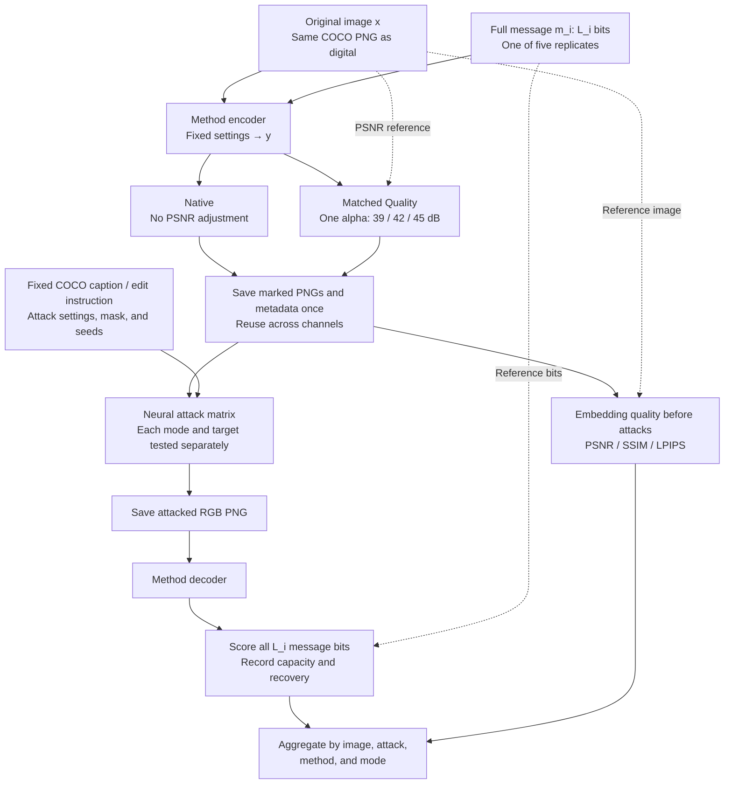

# Neural channel protocol

**Evaluation policy:** report [author reference results, our clean baseline, and paired channel degradation](evaluation-baselines.md). Show absolute recovery and the change from the same saved carrier's clean decoding; published results are contextual references, not the subtraction baseline.

This protocol tests watermark recovery after neural image reconstruction, regeneration, and editing. It follows the [digital channel protocol](digital-channel-protocol.md): the same COCO images, five full-payload message replicates per image and method, Native and Matched Quality modes, and message-recovery metrics. The main change is the attack matrix. Neural-channel output quality is recorded separately from embedding quality.

**Payload policy: full native payload, revision 21 September 2026.** The three channel protocols use one shared embedding bank. The earlier common-30-bit evaluation is not the policy for this run.

**Method update, 29 September 2026:** [Meta Revisited HiDDeN](meta-hidden-revisited.md) replaces the old HiDDeN benchmark entry. Use the same 48-bit, 256×256 crop-based bank as in the digital channel; do not re-embed at 512 or substitute Meta's JND demo. Any resizing required by a neural attack belongs to the recorded channel transform, not to embedding. After removing the three blocked entries, the active scope is 29 entries.

The scope is the 29 existing-image entries in the [model catalogue](model-catalogue.md). The nine generation-time methods are excluded and will have a separate protocol. This is an evaluation of pretrained methods, not a training protocol; method-specific optimisation during embedding remains part of the encoder.

## 1. Images and messages

All methods use the same fixed set of N COCO images, prepared as 512 × 512 RGB PNG files. The image IDs, preprocessing settings, and file hashes are stored in the dataset manifest. The digital and neural experiments use the same source PNGs, not separately prepared copies of the same COCO IDs.

For method i, use its **full supported message length L_i**, following the capacity definition, message generation, and interface rules in [Section 1 of the digital protocol](digital-channel-protocol.md#1-images-and-messages). This is the capacity of the selected checkpoint and configuration at the fixed carrier resolution, not a theoretical maximum of the architecture or a guarantee of error-free recovery. For configurable lengths, document the finite supported candidate set and validate the selected length on a separate setup set before freezing the run. Do not choose a length per image or channel, or shorten messages after seeing attack results.

Generate five reproducible full-length random messages per image. For each (COCO ID, replicate index 1–5), take the first L_i bits of the same frozen seeded master bitstream used in the digital experiment. Equal-length interfaces receive identical messages; unequal-length interfaces share a prefix, but **all L_i bits are embedded and scored**. Reuse each method's exact message in every mode and channel. This gives:

- N × 5 image–message pairs per method in Native mode;
- N × 5 pairs per method **at each PSNR target** in Matched Quality mode.

Cross-method pairing uses **image ID and message-replicate index**, not an assumption that different-length messages are identical. This is not an equal-capacity comparison. Do not repeat a short message to fill a larger payload, add benchmark-level ECC, or score only the first or last 30 bits.

Mandatory native ECC remains part of the selected implementation. Record L_i, the raw/coded output length, reserved positions, bit order, and ECC configuration separately. Reserved detection bits and parity bits are not independent message capacity and must not be overwritten. For a raw-bit interface, score all exposed variable message bits; for a mandatory-ECC interface, score the complete useful message after native decoding and report raw coded-bit errors separately where available. Label these interfaces in every comparison. Keys and reserved-bit settings remain identical between modes and channels.

The planned set contains the following 29 entries:

| Catalogue group | Entries | Methods |
|---|---:|---|
| Existing-image track | 22 | TrustMark-Q, WAM, VideoSeal, PixelSeal, ChunkySeal, VINE-B, VINE-R, RoSteALS, InvisMark, RivaGAN benchmark, DWT-DCT-SVD, MBRS, CIN, Meta Revisited HiDDeN, ARWGAN, SSL Watermarking (multibit), MaskWM, Robust-Wide, SepMark (robust tracing), StegaStamp ONNX benchmark, PIMoG, SSRH |
| Additional integration requirements | 2 | EditGuard (copyright component), SepWater |
| New additions awaiting integration | 5 | TrustMark-B, TrustMark-P, FIN, FNNS (OmniSealBench implementation), DistSeal (post-hoc DC-AE) |
| **Total** | **29** | Checkpoint variants are separate entries, not necessarily independent architectures. |

The run manifest identifies the implementation, checkpoint, payload interface, numerical precision, native resolution, preprocessing, and embedding settings for each entry. The catalogue's integration restrictions still apply: listing a method here does not establish that its weights, adapter, or full-payload interface have passed validation. Missing dependencies or an incompatible interface are reported as blockers, not silently replaced with another method. Check full-message decoding at the author's resolution, after PNG saving, and after adaptation to 512 × 512 where applicable, including FIN. Use the same preflight records as the digital run. DistSeal uses post-hoc embedding into an existing image, not its generation-time mode.

## 2. Embedding modes

### Native

- Embed with the same fixed settings chosen for the digital experiment.
- Do not adjust PSNR.
- Clip and round the output to an 8-bit image, then measure its actual quality.

This mode measures robustness at the selected native configuration and the image distortion that comes with it.

### Matched Quality

The targets are **39, 42, and 45 dB**, measured against the original image **before any attack**. The tolerance is **±0.05 dB**.

For the original image x and encoder output y, scale the embedding residual using one coefficient for the whole image:

$$
y_\alpha = Q\left(\operatorname{clip}\left(x + \alpha(y-x),\,0,\,1\right)\right).
$$

Here, Q rounds to the 8-bit grid. A coefficient above 1 strengthens the residual; a coefficient between 0 and 1 weakens it. PSNR is calculated after clipping and rounding.

The search uses PSNR only, with no decoder feedback. **No pixel-wise correction or mixing of neighbouring candidate images is allowed.** The alpha bounds, search procedure, and stopping rule must be fixed for all methods and recorded before the full run. They must be identical to those used for the corresponding digital run.

For every pair and target, save alpha, achieved PSNR, and matching status. If the search does not find a value within tolerance, retain the diagnostic record but do not label the image as matched. Search failure is not, by itself, proof that the target is mathematically unattainable.

If PSNR matches but the watermark no longer decodes, this is a valid robustness result, not a matching failure. Matched Quality compares robustness at similar pixel distortion **while retaining each method's full selected payload**; it does not equalise payload length or guarantee equal perceptual quality. SSIM and LPIPS are reported alongside PSNR.

Encoder settings are applied before embedding. Quality matching is applied after embedding and before attacks. **No PSNR adjustment is performed after an attack.** The decoder is unchanged between modes and channels. For methods that reconstruct the carrier through an autoencoder, including DistSeal, all quality measurements use the original COCO image as the reference; reconstruction distortion is not subtracted from the embedding budget.

## 3. Pipeline

Embedding is performed once per method and image–message pair. Native and the three Matched Quality images are derived from that same encoder output. Attacks consume the saved PNGs; they do not rerun embedding or matching. Existing digital artifacts can be reused only if their source images, complete messages, payload-interface metadata, key state, checkpoint, embedding settings, scalar-matching specification, and artifact hashes agree with this protocol. The shared bank contains up to 580 × N marked PNGs for all 29 entries and four configurations; changing the channel does not require a new bank.

Each attack starts from the selected pre-attack marked image, not from the output of another attack. The two-pass VAE condition is the only specified chain. The same attack settings, instructions, masks, and repeat seeds are used across watermark methods and embedding modes. Identical seeds couple the repetitions; they do not make different input images produce identical edited content.

## 4. Neural distortions and attacks

| Condition | Parameters | Repeats per level |
|---|---|---:|
| Clean | No transformation; decode the saved marked PNG | 1 |
| VAE reconstruction | SDXL VAE encode using posterior **mode**, then decode; one or two passes; 8-bit clipping and rounding between passes | 1 |
| Diffusion regeneration | SDXL img2img; strength: **0.15, 0.30, 0.50**; guidance: **5.0**; fixed COCO caption | 3 |
| Instruction editing: lighting | InstructPix2Pix; `make the image look like it was taken at golden hour`; guidance: **7.5**; image guidance: **1.8** | 3 |
| Instruction editing: style | InstructPix2Pix; `turn the image into a watercolor painting`; guidance: **7.5**; image guidance: **1.2** | 3 |
| Local inpainting | SDXL inpainting; central **25% of image area**; strength: **0.99**; guidance: **7.5**; fixed COCO caption | 3 |

For each COCO image, select the caption with the smallest annotation ID in `captions_val2017.json`. Store the selected text and annotation-file hash in the manifest. The caption is taken from the original data, not generated from each marked image or rewritten to improve watermark removal. The two instruction-editing conditions use the exact instruction strings above, not the COCO caption.

At 512 × 512, the inpainting mask is the half-open rectangle **[128, 384) × [128, 384)**. White pixels identify the region to repaint. The pipeline output is evaluated directly; do not paste the original background back over it. Changes outside the mask are measured, not assumed absent.

### Attack models and execution settings

| Purpose | Checkpoint repository | Pinned revision |
|---|---|---|
| SDXL img2img and VAE | [stabilityai/stable-diffusion-xl-base-1.0](https://huggingface.co/stabilityai/stable-diffusion-xl-base-1.0/tree/462165984030d82259a11f4367a4eed129e94a7b) | `462165984030d82259a11f4367a4eed129e94a7b` |
| Instruction editing | [timbrooks/instruct-pix2pix](https://huggingface.co/timbrooks/instruct-pix2pix/tree/31519b5cb02a7fd89b906d88731cd4d6a7bbf88d) | `31519b5cb02a7fd89b906d88731cd4d6a7bbf88d` |
| SDXL inpainting | [diffusers/stable-diffusion-xl-1.0-inpainting-0.1](https://huggingface.co/diffusers/stable-diffusion-xl-1.0-inpainting-0.1/tree/115134f363124c53c7d878647567d04daf26e41e) | `115134f363124c53c7d878647567d04daf26e41e` |

- Request **20 inference steps** for each stochastic pipeline; use an empty negative prompt. Strength can reduce the actual number of denoising steps. Record the actual timesteps and executed step count, not just the requested value.
- Use `EulerAncestralDiscreteScheduler` for InstructPix2Pix. For the two SDXL pipelines, use the scheduler and configuration distributed with their pinned checkpoint. Record the scheduler configuration and library versions.
- Use FP16 for the diffusion/editing pipelines, retaining the checkpoint's required VAE upcasting; use FP32 for the standalone VAE reconstruction conditions. Record component precision and any offloading settings. Do not silently substitute lower-precision weights or quantisation.
- Use the 512 × 512 input and output grid. Record pipeline preprocessing and SDXL size-conditioning settings; do not silently add a 1024-pixel resize, refiner, super-resolution stage, or JPEG conversion.
- Disable the SDXL pipeline's additional output watermark so that it does not introduce an unrelated watermark into the experiment. Record safety-checker settings; safety-blocked outputs and placeholders are logged as blocked generation, not decoded as genuine attack outputs.
- Precompute and store three seeds for each stochastic condition and image–message pair. Reinitialise the generator for each task and reuse the same seeds across methods and modes. A seed mapping must not depend on execution order, N, or which jobs have already completed.
- Save valid attack outputs as clipped, rounded, 8-bit RGB PNGs before decoding. Do not select the best or worst seed, adjust attack parameters using decoder feedback, or apply adaptive restoration before extraction.

There are **21 conditions**, including repeats and Clean, per image–message pair and mode configuration: 1 Clean + 2 VAE + 9 img2img + 6 instruction edits + 3 inpainting.

With five messages and four configurations (Native plus three PSNR targets), the complete matrix is **420 × N decoding evaluations per method**. For 29 entries, the planned maximum is **12,180 × N**: 60,900 evaluations at N = 5, or 1,218,000 at N = 100. These counts include Clean, exclude any separate negative-control campaign, and assume every entry is runnable and every matching target succeeds. Technical failures and matching failures are reported against the planned matrix rather than erased from it.

## 5. Metrics

The primary metrics are the same as in the digital channel.

| Quantity | Measurement |
|---|---|
| Payload | Full variable message length L_i in bits; L_i / (512 × 512) in bits per pixel; raw/coded length, reserved positions, and ECC reported separately |
| Message errors | Full-message BER: number of incorrect information bits divided by L_i, at the declared raw or post-ECC message interface |
| Bit accuracy | 1 − BER |
| Exact recovery | Fraction of full L_i-bit messages recovered without error; secondary, length-dependent metric, not a direct ranking across unequal payload lengths |
| Embedding quality | PSNR, SSIM, and LPIPS between the original and marked image **before attacks** |
| Computational cost | Embedding and extraction time, with hardware and execution settings; neural attack time is recorded separately |
| Quality matching | Fraction within tolerance, achieved PSNR, alpha, and failure reason |

The decoder returns recovered bits before comparison with the expected message. Reference bits are used for scoring, not to select the decoder output. Score complete decoded strings even when many bits are wrong. Missing strings and length mismatches have no defined BER. A native ECC rejection is a failed full-message recovery; post-ECC BER is unavailable if no message is returned. Report explicit rejections and their coverage separately from infrastructure failures. Keep Clean failures in the records and include their valid bit strings in Clean and attack statistics; do not condition the main attack results on successful Clean recovery.

Neural-channel diagnostics are separate from embedding quality: save attack input/output pairs and measure their PSNR, SSIM, and LPIPS. For inpainting, also report mean absolute pixel change inside and outside the mask. These describe the extent of editing; a large difference after an intentional style change is not automatically an invalid attack. They do not establish semantic preservation or instruction compliance. Inspect content changes and editing failures without choosing examples based on watermark recovery, and do not silently remove failed edits from the robustness tables.

Watermark detection and message recovery are different tasks. This protocol does not require the generation-time track's negative-generation or threshold-calibration campaign. A claim of TPR at a given FPR would require a separately specified calibration and unwatermarked test set. Neither theoretical guessing probabilities nor full-message BER establish empirical FPR.

## 6. Aggregation and comparison

- Average random repeats and messages within each image, then average across images.
- Report each attack condition and severity separately.
- For an overall robustness score, use **four families**: VAE reconstruction, diffusion regeneration, instruction editing, and inpainting. Average levels/tasks within each family and give the four families equal weight. Lighting and style are two tasks within instruction editing. Report Clean separately, outside this score.
- Use image-level bootstrap sampling with 2,000 resamples to obtain 95% confidence intervals. Messages and attack repeats are not treated as independent images. Fix and record the bootstrap seed.
- Keep Native and the three Matched Quality targets in separate tables. Show L_i, bits per pixel, actual embedding quality, Clean BER, attacked BER, exact recovery, cost, and coverage together. Distinguish raw-message and post-ECC results rather than pooling them into one unqualified ranking. Do not pool bits across methods into one capacity-weighted average.
- Report matching coverage for every method and target. Pairwise Matched Quality comparisons use common image IDs and message-replicate indices that meet the target for both methods, with the comparison sample size stated. Full messages may have different lengths. Do not compare different surviving subsets as if they were paired.
- Record failed or blocked generation, missing outputs, and extraction errors separately from valid decoding errors. A valid extracted message with wrong bits is a robustness result; a process crash is not BER = 0 or BER = 1. Report task coverage alongside every aggregate and do not hide missing levels in a complete-looking score.
- Digital-versus-neural comparisons use corresponding method, checkpoint, image, message, and pre-attack PNG. Compare family profiles; a digital macro-average over eight families and a neural macro-average over four are not the same measurement scale.

Native answers: how much payload does this selected configuration carry, with what image distortion and recovery under neural transformations? Matched Quality asks the same question at the specified pre-attack PSNR, retaining that payload. Neither mode establishes robustness to every neural editor or a causal explanation of architectural differences.

This is a **capacity–quality–robustness comparison, not an equal-payload experiment**. BER normalises bit errors, not embedding load; exact recovery depends on message length. Interpret the joint trade-off and within-method changes across channels, not a bare BER leaderboard as proof of a universal winner. Equal-payload claims require a separate compatible-configuration comparison with equal actual information length, not a shorter scoring window. Do not present L_i × (1 − BER) as guaranteed usable throughput or channel capacity.

## 7. Scope, reuse, and run records

This is the specification for the next neural-channel run, not a claim that all 29 entries have already been implemented or tested. The five-image run checks the full matrix on a small sample; changing N to 100 must not change messages, matching rules, attacks, or previously assigned seeds. A five-image result is not the main 100-image experiment.

Store source and marked PNGs, payloads and required key state, alpha records, captions, masks, attack configurations, output hashes, per-task metrics, logs, dependency versions, and checkpoint hashes in persistent storage. Private key material need not be published, but the run must retain what is required to reproduce extraction. A completed task is reusable only after its specification and input/output hashes are validated. File existence alone is not a completion check. Partially written tasks remain incomplete; resuming the same run must not recompute valid embedding or attack artifacts unnecessarily.

The execution manifest must freeze the remaining shared details before the full run: model-specific adapters and settings, selected full-payload lengths and interfaces, message generation, scalar-search bounds and stopping rules, seed mapping, preprocessing, metric implementations, dependency locks, and device/precision settings. These choices cannot be tuned separately for a favourable neural-channel result.

Older runs with common-30-bit scoring, a pixel-wise PSNR fallback, a single assigned message per image, or a different target set keep their original protocol description and files. Full-message metrics may be recomputed only from verified complete expected/decoded bit strings; this does not turn fixed filler into new random messages. Reuse requires actual artifact compatibility. Changed payloads, adapters, or assignments require a new versioned bank, not overwriting or mixing old results. This documentation revision does not modify the released notebook.

Generation-time watermarking, training new watermarking models, physical capture, and decoder-aware adversarial optimisation are outside this document.
