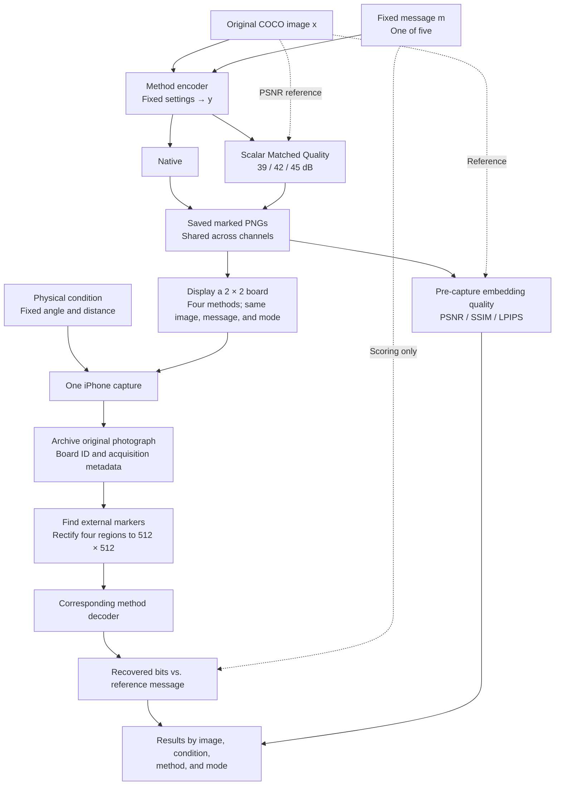

# Physical channel protocol

This protocol tests watermark recovery after **screen–camera transmission**. It follows the [digital](digital-channel-protocol.md) and [neural](neural-channel-protocol.md) protocols: the same COCO carriers and messages, Native and Matched Quality modes, and message-recovery metrics. The marked images are displayed on a monitor and captured with an iPhone 15. Printing is not part of this experiment.

The acquisition uses a **2 × 2 grid of four marked images**, with **one captured photograph per board and physical condition**. There are no three-shot repeats and no best-frame selection. Extraction is assisted by external geometric markers; this is not a test of unaided image localisation.

## 1. Images, messages, and methods

Use the same fixed set of N COCO images, prepared as 512 × 512 RGB PNG files. Source IDs, preprocessing, and file hashes must agree with the corresponding digital and neural runs. N = 5 is the small validation run; N = 100 is the planned main run. Increasing N must not change the settings or task assignments of existing images.

Each image is tested with five fixed 30-bit messages, shared across methods, modes, and channels. This gives N × 5 image–message pairs per method in Native mode and N × 5 pairs **at each Matched Quality target**.

For longer payloads, score the **last 30 bits** and retain the same fixed filling rule for all other positions. This aligns the evaluated segment, not the total embedded capacity. Reserved bits, keys, and ECC settings remain unchanged between channels. A method that requires CRC/BCH uses its useful-message interface, with coded length and post-ECC results reported separately from raw-bit results; parity or reserved bits are not overwritten.

The planned set contains the same 32 existing-image entries as the neural protocol:

| Catalogue group | Entries | Methods |
|---|---:|---|
| Common image-message track | 22 | TrustMark-Q, WAM, VideoSeal, PixelSeal, ChunkySeal, VINE-B, VINE-R, RoSteALS, InvisMark, RivaGAN benchmark, DWT-DCT-SVD, MBRS, CIN, HiDDeN benchmark, ARWGAN, SSL Watermarking (multibit), MaskWM, Robust-Wide, SepMark (robust tracing), StegaStamp ONNX benchmark, PIMoG, SSRH |
| Additional integration requirements | 5 | EditGuard (copyright component), OmniGuard (copyright component), SepWater, Fang Screen-Shooting Resilient Watermarking, Camera-Shooting Instance |
| New additions awaiting integration | 5 | TrustMark-B, TrustMark-P, FIN, FNNS (OmniSealBench implementation), DistSeal (post-hoc DC-AE) |
| **Total** | **32** | Entries include checkpoint variants; they are not 32 independent architectures. |

The nine generation-time methods are excluded. Inclusion here does not establish that an adapter or checkpoint has passed validation. The [catalogue](model-catalogue.md) restrictions, including FIN's resolution adaptation and the unverified interfaces, remain in force. Missing weights, dependencies, or an incompatible payload interface are explicit blockers, not permission to substitute another method.

## 2. Embedding modes

### Native

- Embed with the fixed method settings used for the corresponding digital run.
- Do not adjust PSNR.
- Clip and round to the 8-bit grid, save the PNG, and measure its actual embedding quality.

### Matched Quality

Use targets of **39, 42, and 45 dB**, with tolerance **±0.05 dB**, measured against the original image **before display and capture**.

For original image x and encoder output y:

$$
y_\alpha = Q\left(\operatorname{clip}\left(x + \alpha(y-x),\,0,\,1\right)\right).
$$

Q rounds to the 8-bit grid. One scalar alpha controls the entire residual. The search uses PSNR only, without decoder feedback. **No pixel-wise correction or mixing of neighbouring candidates is allowed.** The alpha bounds, search procedure, and stopping rule must be fixed in advance and identical across the three channel experiments.

Save alpha, achieved PSNR, matching status, and failure reason for every pair and target. A candidate outside tolerance is not labelled matched. Search failure does not prove mathematical unattainability. If matching succeeds but the watermark does not decode, that remains a valid robustness result.

Matched Quality aligns pixel distortion, not perceptual quality; also report SSIM and LPIPS. The reference remains the original COCO image, including for methods that reconstruct it through an autoencoder. Encoder and decoder settings do not change in response to physical-channel results. **Do not adjust PSNR after photography or rectification.**

Embedding is performed once per method and image–message pair. Native and all matched candidates come from that same encoder output. Reuse previously saved PNGs only when source hashes, messages, keys, checkpoint, embedding settings, and the scalar-matching specification agree. Do not re-embed specifically for a different angle or screen.

## 3. Pipeline and four-image acquisition

### Display board

- The primary display is one monitor operating at **2560 × 1440 physical pixels**, subject to hardware verification. Record its exact model, panel dimensions, refresh rate, display profile, brightness setting, and connection. The label “2K” alone does not identify these properties.
- Display each image at **512 × 512 panel pixels** in a centred 2 × 2 layout. Verify actual output scaling with a pixel-grid test; a 512-pixel UI rectangle is not sufficient evidence of 1:1 presentation. Disable fit-to-window scaling and transitions. Freeze colour-management settings and record them.
- Put fiducial markers, borders, and a board identifier **outside** the four image regions. Fix their geometry, colours, and background before the run. Markers identify geometry and jobs; they do not encode the hidden message or recovered bits. Archive the complete board layout and displayed raster.
- Each board contains four different methods using the **same COCO image, message, and mode/PSNR target**. This keeps scene content comparable within a photograph. The 32 entries form eight boards for each image–message–mode combination when all entries are available.
- Precompute method grouping, slot assignment, and board order. Balance each method across the four positions over the image/message set; preserve the assignment across physical conditions and embedding modes. Do not require four extra photographs to rotate every individual task through all positions.
- If a reserved slot is blocked or unmatched, retain its assignment and show the corresponding unmarked source as a labelled placeholder in the manifest. It is not a completed watermark trial. Do not move other methods into a more favourable slot after seeing results. A board with no eligible trials can be skipped with all affected statuses recorded.

### Camera and capture loop

Use one iPhone 15 on a stable mount, with the selected rear camera, orientation, capture resolution, and capture software fixed for the campaign. A Mac controls presentation and acquisition. USB [Continuity Camera](https://support.apple.com/en-us/102546) is a candidate transport, not a claim that captured frames are identical to the iPhone's stock Camera photos. Verify the actual capture interface, output format, resolution, and processing before the main run; do not mix video-stream frames and full-resolution still-photo modes within one campaign.

Disable optional portrait/background effects, automatic reframing, beauty filters, and flash where applicable. Fix the focus/exposure/white-balance policy for the whole run: record which settings can be locked and which remain automatic. Do not claim unavailable manual controls are fixed. Keep monitor auto-brightness, HDR, and adaptive/night colour settings off. Use stable room lighting, record illuminance at a stated location and any session changes, and avoid daylight drift where possible.

For each scheduled board:

1. Present the complete board and wait for the predefined display/camera settling interval.
2. Trigger **one acquisition**, or accept the one predetermined post-settling frame if the fixed interface is stream-based. Do not use a burst and choose the sharpest or best-decoding frame.
3. Save the original capture and metadata locally, verify the board identity and file integrity, and checkpoint the job to persistent storage.
4. Advance only after the capture record has been committed. Cropping and watermark decoding may run later; they do not need to hold up acquisition.

The settling rule is chosen on a separate setup pilot and then frozen. Five seconds per board is a planning assumption, not a measured guarantee. A failed command or incomplete transfer can be retried under a fixed logged infrastructure-retry policy. All attempts remain in the acquisition log. A valid capture is not replaced because it is blurred, its markers are difficult to locate, or its watermark decodes poorly.

### Extraction of the four regions

Use one marker-based geometric procedure for all methods and modes. Estimate the planar mapping from the external markers and known board geometry, then resample each inner image region directly to **512 × 512 RGB**. A [homography](https://docs.opencv.org/4.13.0/d9/dab/tutorial_homography.html) provides perspective rectification; it does not recover optical detail lost in capture. Fix the marker detector, correspondence rules, any independently calibrated lens correction, interpolation, and colour conversion before evaluation. Avoid repeated resize/warp stages.

Archive the source photograph, marker coordinates, transforms, source-region dimensions in camera pixels, rectification status, and the four rectified PNGs. A 512 × 512 display tile does not imply 512 independently resolved camera pixels. Do not sharpen, denoise, colour-match to the original, or search for the crop with the lowest BER. Manual rescue crops, if examined, belong in a separate diagnostic analysis.

The tested system is therefore **screen–camera capture with common marker-assisted rectification**. Results do not establish that a watermark decoder can locate its image unaided or tolerate the same perspective without correction.

## 4. Physical conditions

The main matrix contains **seven physical conditions**, with **one capture per board per condition**. Change one geometric factor relative to the baseline; this is not a full Cartesian product of angles and distances.

| ID | Camera position relative to the board centre | Nominal lens-to-board-centre distance | Captures per board |
|---|---|---:|---:|
| `screen_baseline` | On the display normal; yaw 0°, pitch 0° | 70 cm | 1 |
| `screen_yaw15` | 15° horizontal off-axis view | 70 cm | 1 |
| `screen_yaw30` | 30° horizontal off-axis view | 70 cm | 1 |
| `screen_pitch15` | 15° vertical off-axis view | 70 cm | 1 |
| `screen_pitch30` | 30° vertical off-axis view | 70 cm | 1 |
| `screen_near` | On-axis; same displayed tile size | 40 cm | 1 |
| `screen_far` | On-axis; same displayed tile size | 100 cm | 1 |

These are nominal setup targets, not measurements already obtained from the user's equipment. Validate visibility of all four tiles and markers on the setup pilot. If the apparatus cannot support these distances, amend and version the geometry for the entire campaign before the main run; do not adapt distance separately for difficult models.

For the angle conditions, place the lens on an arc around the board centre at the stated distance and aim it at the centre. Horizontal displacement is to one fixed side, and vertical displacement is upwards; record the side and actual measured pose. Keep camera roll at zero. The angles describe an off-axis view of the screen, not a rotation of the saved photograph. Record nominal and measured distances/angles and the apparatus measurement precision. Do not move closer or zoom in to restore tile size after changing condition.

Brightness, ambient lighting, refresh rate, screen size, and camera policy remain fixed in this matrix. They are recorded apparatus variables, not additional hidden factors. Each condition begins from the same saved marked PNG, never from a previously photographed image.

Also run the **digital Clean control** by decoding each saved marked PNG directly. This control needs no photograph and is not the physical baseline: even a frontal photograph already includes the screen–camera channel.

### Workload

For 32 entries, five messages, and four mode configurations:

- Saved marked images: **32 × N × 5 × 4 = 640 × N**.
- Physical tile evaluations: **640 × N × 7 = 4,480 × N**.
- Four tiles per photograph: **1,120 × N captures** for one display/camera pair.
- Digital Clean controls: another **640 × N** decoding evaluations, which can be reused from a compatible run.

| Test images N | Marked PNGs | Physical captures | Physical tile evaluations | Capture time at 5 seconds per board |
|---|---:|---:|---:|---|
| 5 | 3,200 | 5,600 | 22,400 | 7 h 46 min 40 s |
| 100 | 64,000 | 112,000 | 448,000 | 155 h 33 min 20 s, approximately 6.5 continuous days |

These are planned full-matrix counts assuming all entries and PSNR targets are available. They exclude setup, changing camera position, infrastructure retries, storage overhead, and decoding. Additional displays are separate campaigns and increase the workload. Blocked or unmatched tasks remain visible in coverage records rather than silently reducing the declared experimental scope.

## 5. Metrics

| Quantity | Measurement |
|---|---|
| Message errors | BER over the common 30-bit segment for valid extracted bit strings |
| Bit accuracy | 1 − BER |
| Exact recovery | Fraction of evaluated messages with all 30 bits recovered correctly; distinguish conditional decoder recovery from the end-to-end result below |
| Full payload | Payload length and full-message errors, separately from the common segment; distinguish raw and post-ECC outputs |
| Embedding quality | PSNR, SSIM, and LPIPS between the original COCO image and marked PNG **before display** |
| Quality matching | Achieved PSNR, alpha, fraction within tolerance, and failure reason |
| Acquisition and rectification | Capture completion, correct board association, localisation/rectification success, and tile dimensions in the original photograph |
| Computational cost | Embedding, acquisition, rectification, and extraction time separately, with hardware and software settings |

Use reference bits only after extraction for scoring. Report BER on decodable cases together with its coverage; do not invent a BER for a missing crop or missing bit string. For valid, correctly associated photographs, also report **end-to-end exact recovery** over eligible tiles: a tile that cannot be rectified or for which the decoder returns no message is an unsuccessful recovery. Infrastructure failures, blocked methods, and failed matching are listed separately from captured-but-unsuccessful trials.

As channel diagnostics, compute PSNR, SSIM, and LPIPS between each saved marked PNG and its rectified photograph using a fixed colour-conversion implementation. These include display/camera colour response and alignment error; they are not interchangeable with embedding quality and are not used to re-match PSNR or reject photographs. Record unmarked placeholder tiles as controls only if their separate control role is specified; their presence does not establish a calibrated false-positive rate.

## 6. Aggregation and comparison

- Average the five messages within each image, then average across images. There are **no repeated captures to average** in the main matrix.
- Report all seven physical conditions separately, along with digital Clean. The frontal physical baseline is not labelled distortion-free.
- As a secondary stress summary, average the two levels within each of three families—horizontal angle, vertical angle, and distance—and give the three families equal weight. Report the physical baseline separately. This score is not numerically interchangeable with the digital or neural macro-average.
- Keep Native and each Matched Quality target in separate tables. Pairwise matched comparisons use the common eligible image–message pairs and state the sample size. Show both matching and acquisition/rectification coverage; do not hide missing cases behind averages over survivors.
- For 95% confidence intervals, use 2,000 paired image-level bootstrap resamples with a fixed seed. Each resampled image carries all its messages, modes, conditions, boards, and tiles across methods. Because a board contains only one COCO image, this preserves the shared-frame dependence rather than treating its four tiles as independent photographs.
- Preserve frame IDs, tile positions, device/display IDs, timestamps, and session blocks. These intervals describe image-sampling uncertainty conditional on the apparatus and sessions, not independent replication across phones, displays, or repeated captures. A single capture per task cannot estimate its shot-to-shot variance.
- Schedule methods and modes in balanced, interleaved order within each fixed physical condition. Record interruptions and session changes. Do not put one method consistently in a favourable slot or a different lighting session.
- Compare channels using the same pre-attack PNG and source records. Interpret the result as performance on the specified marker-assisted screen–camera setup, not all possible physical transmission.

## 7. Scope, reuse, and run records

The primary campaign uses **one QHD display and one iPhone 15**, with the seven conditions above. Full HD and MacBook displays can be evaluated later using separately registered apparatus settings; their results must not be pooled as if only resolution changed. Different physical sizes, pixel densities, display profiles, and brightness can also differ. Printing, scanning, paper deformation, deliberate glare, hand-held shake, and generation-time watermarking are outside this version.

Before the main run, use a separate setup pilot to verify 1:1 display scaling, four-tile visibility, camera resolution, marker detection, colour conversion, settling time, and persistent saving. Freeze the board layout, placement schedule, apparatus geometry, capture policy, and rectification configuration. Do not optimise those settings separately for each watermark method or select the layout by retaining only favourable decoding cases.

Keep the source and marked PNGs, full board manifest, messages and required key state, matching records, original captures, crop transforms, rectified PNGs, per-task results, logs, and file hashes in persistent storage. Record camera/display and software versions, checkpoint hashes, precision, actual exposure metadata where available, and the dates and measured geometry of each session. Preserve original capture files without messenger recompression; decoded RGB derivatives do not replace those originals.

Resume by validated job specification and input/output hashes, not filenames alone. Do not recapture or re-embed completed valid tasks. Partial transfers remain incomplete, and retries retain their provenance. Decoding can resume independently from the saved photographs. A technically complete queue is not proof that every planned method or matching target was available.

This document is the specification for the next physical run, not a claim that acquisition software or all 32 model adapters have already been implemented and verified. Older single-image pilots and earlier pixel-wise PSNR-matching runs keep their original descriptions unless their records establish compatibility.
