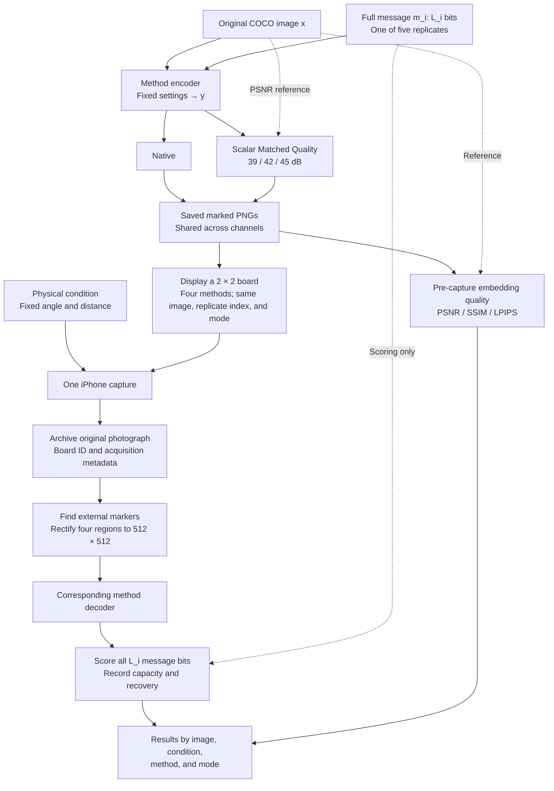

# Physical channel protocol

**Evaluation policy:** report [author reference results, our clean baseline, and paired channel degradation](evaluation-baselines.md). Show absolute recovery and the change from the same saved carrier's clean decoding; published results are contextual references, not the subtraction baseline. The frontal photograph is not a distortion-free control.

This protocol tests watermark recovery after **screen–camera transmission**. It follows the [digital](digital-channel-protocol.md) and [neural](neural-channel-protocol.md) protocols: the same COCO carriers, five full-payload message replicates per image and method, Native and Matched Quality modes, and message-recovery metrics. The marked images are displayed on a monitor and captured with an iPhone 15. Printing is not part of this experiment.

**Payload policy: full native payload, revision 21 September 2026.** The three channel protocols use one shared embedding bank. The earlier common-30-bit evaluation is not the policy for this run.

**Method update, 29 September 2026:** [Meta Revisited HiDDeN](meta-hidden-revisited.md) replaces the old HiDDeN benchmark entry. Its saved carrier is 256×256 with 48 message bits, identical across all channels. The screen-camera implementation must explicitly record any display scaling and its rectification grid; the 512-pixel COCO source is not this method's marked carrier. Do not silently upsample the embedding bank or pool old HiDDeN scores with Meta. After removing the three blocked entries, the active scope is 29 entries.

The acquisition uses a **2 × 2 grid of four marked images**, with **one captured photograph per board and physical condition**. There are no three-shot repeats and no best-frame selection. Extraction is assisted by external geometric markers; this is not a test of unaided image localisation.

## 1. Images, messages, and methods

Use the same fixed set of N COCO images, prepared as 512 × 512 RGB PNG files. Source IDs, preprocessing, and file hashes must agree with the corresponding digital and neural runs. N = 5 is the small validation run; N = 100 is the planned main run. Increasing N must not change the settings or task assignments of existing images.

For method i, use its **full supported message length L_i**, following the capacity definition, message generation, and interface rules in [Section 1 of the digital protocol](digital-channel-protocol.md#1-images-and-messages). This is the capacity of the selected checkpoint and configuration at the fixed carrier resolution, not a theoretical maximum of the architecture or a guarantee of error-free recovery. For configurable lengths, document the finite supported candidate set and validate the selected length on a separate setup set before freezing the run. Do not shorten messages for a difficult screen, angle, image, or PSNR target.

Generate five reproducible full-length random messages per image. For each (COCO ID, replicate index 1–5), take the first L_i bits of the same frozen seeded master bitstream used in the digital experiment. Equal-length interfaces receive identical messages; unequal-length interfaces share a prefix, but **all L_i bits are embedded and scored**. Reuse each method's exact message across modes and channels. This gives N × 5 image–message pairs per method in Native mode and N × 5 pairs **at each Matched Quality target**. Cross-method pairing uses image ID and message-replicate index; full messages need not have the same length.

Do not repeat a short message to fill a larger payload, add benchmark-level ECC, or score only the first or last 30 bits. Mandatory native ECC remains part of the selected implementation. Record L_i, raw/coded output length, reserved positions, bit order, and ECC configuration separately. Reserved detection bits and parity bits are not independent message capacity and must not be overwritten. For a raw-bit interface, score all exposed variable message bits; for a mandatory-ECC interface, score the complete useful message after native decoding and report raw coded-bit errors separately where available. Label these interfaces in every comparison. Keys and reserved-bit settings remain identical between modes and channels.

The planned set contains the same 29 existing-image entries as the neural protocol:

| Catalogue group | Entries | Methods |
|---|---:|---|
| Existing-image track | 22 | TrustMark-Q, WAM, VideoSeal, PixelSeal, ChunkySeal, VINE-B, VINE-R, RoSteALS, InvisMark, RivaGAN benchmark, DWT-DCT-SVD, MBRS, CIN, Meta Revisited HiDDeN, ARWGAN, SSL Watermarking (multibit), MaskWM, Robust-Wide, SepMark (robust tracing), StegaStamp ONNX benchmark, PIMoG, SSRH |
| Additional integration requirements | 2 | EditGuard (copyright component), SepWater |
| New additions awaiting integration | 5 | TrustMark-B, TrustMark-P, FIN, FNNS (OmniSealBench implementation), DistSeal (post-hoc DC-AE) |
| **Total** | **29** | Entries include checkpoint variants; they are not 29 independent architectures. |

The nine generation-time methods are excluded. Inclusion here does not establish that an adapter or checkpoint has passed validation. The [catalogue](model-catalogue.md) restrictions, including FIN's resolution adaptation and the unverified interfaces, remain in force. Missing weights, dependencies, or an incompatible payload interface are explicit blockers, not permission to substitute another method.

Use the shared preflight records for full-message decoding at the author's resolution, after PNG saving, and after adaptation to 512 × 512 where applicable. Validate the payload interface before the full run; do not hide clean recovery errors by selecting favourable images or reducing message length.

## 2. Embedding modes

### Native

- Embed with the fixed method settings used for the corresponding digital run.
- Do not adjust PSNR.
- Clip and round to the 8-bit grid, save the PNG, and measure its actual embedding quality.

### Matched Quality

Use targets of **39, 42, and 45 dB**, with tolerance **±0.05 dB**, measured against the original image **before display and capture**.

For original image x and encoder output y:

$$
y_\alpha = Q\left(\operatorname{clip}\left(x + \alpha(y-x),\,0,\,1\right)\right).
$$

Q rounds to the 8-bit grid. One scalar alpha controls the entire residual. The search uses PSNR only, without decoder feedback. **No pixel-wise correction or mixing of neighbouring candidates is allowed.** The alpha bounds, search procedure, and stopping rule must be fixed in advance and identical across the three channel experiments.

Save alpha, achieved PSNR, matching status, and failure reason for every pair and target. A candidate outside tolerance is not labelled matched. Search failure does not prove mathematical unattainability. If matching succeeds but the watermark does not decode, that remains a valid robustness result.

Matched Quality aligns pixel distortion **while retaining each method's full selected payload**; it does not equalise payload length or perceptual quality. Also report SSIM and LPIPS. The reference remains the original COCO image, including for methods that reconstruct it through an autoencoder. Encoder and decoder settings do not change in response to physical-channel results. **Do not adjust PSNR after photography or rectification.**

Embedding is performed once per method and image–message pair. Native and all matched candidates come from that same encoder output. Reuse previously saved PNGs only when source hashes, complete messages, payload-interface metadata, keys, checkpoint, embedding settings, and the scalar-matching specification agree. Do not re-embed specifically for a different angle or screen.

## 3. Pipeline and four-image acquisition

### Display board

- The primary display is one monitor operating at **2560 × 1440 physical pixels**, subject to hardware verification. Record its exact model, panel dimensions, refresh rate, display profile, brightness setting, and connection. The label “2K” alone does not identify these properties.
- Display each image at **512 × 512 panel pixels** in a centred 2 × 2 layout. Verify actual output scaling with a pixel-grid test; a 512-pixel UI rectangle is not sufficient evidence of 1:1 presentation. Disable fit-to-window scaling and transitions. Freeze colour-management settings and record them.
- Put fiducial markers, borders, and a board identifier **outside** the four image regions. Fix their geometry, colours, and background before the run. Markers identify geometry and jobs; they do not encode the hidden message or recovered bits. Archive the complete board layout and displayed raster.
- Each board contains four different methods using the **same COCO image, message-replicate index, and mode/PSNR target**. Full message lengths can differ between tiles. This keeps scene content comparable within a photograph without pretending that payloads are equal. The 29 entries form eight boards (the last has one data tile and three fixed non-scored fillers) for each image–replicate–mode combination when all entries are available.
- Precompute method grouping, slot assignment, and board order. Balance each method across the four positions over the image/message set; preserve the assignment across physical conditions and embedding modes. Do not require four extra photographs to rotate every individual task through all positions.
- If a reserved slot is blocked or unmatched, retain its assignment and show the corresponding unmarked source as a labelled placeholder in the manifest. It is not a completed watermark trial. Do not move other methods into a more favourable slot after seeing results. A board with no eligible trials can be skipped with all affected statuses recorded.

### Camera and capture loop

Use one iPhone 15 on a stable mount, with the selected rear camera, orientation, capture resolution, and capture software fixed for the campaign. A Mac controls presentation and acquisition. USB [Continuity Camera](https://support.apple.com/en-us/102546) is a candidate transport, not a claim that captured frames are identical to the iPhone's stock Camera photos. Verify the actual capture interface, output format, resolution, and processing before the main run; do not mix video-stream frames and full-resolution still-photo modes within one campaign.

Disable optional portrait/background effects, automatic reframing, beauty filters, and flash where applicable. Fix the focus/exposure/white-balance policy for the whole run: record which settings can be locked and which remain automatic. Do not claim unavailable manual controls are fixed. Keep monitor auto-brightness, HDR, and adaptive/night colour settings off. Use stable room lighting, record illuminance at a stated location and any session changes, and avoid daylight drift where possible.

For each scheduled board:

1. Present the complete board and wait for the predefined display/camera settling interval.
2. Trigger **one acquisition**, or accept the one predetermined post-settling frame if the fixed interface is stream-based. Do not use a burst and choose the sharpest or best-decoding frame.
3. Save the original capture and metadata locally, verify the board identity and file integrity, and checkpoint the job to persistent storage.
4. Advance only after the capture record has been committed. Cropping and watermark decoding may run later; they do not need to hold up acquisition.

The settling rule is chosen on a separate setup pilot and then frozen. Five seconds per board is a planning assumption, not a measured guarantee. A failed command or incomplete transfer can be retried under a fixed logged infrastructure-retry policy. All attempts remain in the acquisition log. A valid capture is not replaced because it is blurred, its markers are difficult to locate, or its watermark decodes poorly.

### Extraction of the four regions

Use one marker-based geometric procedure for all methods and modes. Estimate the planar mapping from the external markers and known board geometry, then resample each inner image region directly to **512 × 512 RGB**. A [homography](https://docs.opencv.org/4.13.0/d9/dab/tutorial_homography.html) provides perspective rectification; it does not recover optical detail lost in capture. Fix the marker detector, correspondence rules, any independently calibrated lens correction, interpolation, and colour conversion before evaluation. Avoid repeated resize/warp stages.

Archive the source photograph, marker coordinates, transforms, source-region dimensions in camera pixels, rectification status, and the four rectified PNGs. A 512 × 512 display tile does not imply 512 independently resolved camera pixels. Do not sharpen, denoise, colour-match to the original, or search for the crop with the lowest BER. Manual rescue crops, if examined, belong in a separate diagnostic analysis.

The tested system is therefore **screen–camera capture with common marker-assisted rectification**. Results do not establish that a watermark decoder can locate its image unaided or tolerate the same perspective without correction.

## 4. Physical conditions

The main matrix contains **seven physical conditions**, with **one capture per board per condition**. Change one geometric factor relative to the baseline; this is not a full Cartesian product of angles and distances.

| ID | Camera position relative to the board centre | Nominal lens-to-board-centre distance | Captures per board |
|---|---|---:|---:|
| `screen_baseline` | On the display normal; yaw 0°, pitch 0° | 70 cm | 1 |
| `screen_yaw15` | 15° horizontal off-axis view | 70 cm | 1 |
| `screen_yaw30` | 30° horizontal off-axis view | 70 cm | 1 |
| `screen_pitch15` | 15° vertical off-axis view | 70 cm | 1 |
| `screen_pitch30` | 30° vertical off-axis view | 70 cm | 1 |
| `screen_near` | On-axis; same displayed tile size | 40 cm | 1 |
| `screen_far` | On-axis; same displayed tile size | 100 cm | 1 |

These are nominal setup targets, not measurements already obtained from the user's equipment. Validate visibility of all four tiles and markers on the setup pilot. If the apparatus cannot support these distances, amend and version the geometry for the entire campaign before the main run; do not adapt distance separately for difficult models.

For the angle conditions, place the lens on an arc around the board centre at the stated distance and aim it at the centre. Horizontal displacement is to one fixed side, and vertical displacement is upwards; record the side and actual measured pose. Keep camera roll at zero. The angles describe an off-axis view of the screen, not a rotation of the saved photograph. Record nominal and measured distances/angles and the apparatus measurement precision. Do not move closer or zoom in to restore tile size after changing condition.

Brightness, ambient lighting, refresh rate, screen size, and camera policy remain fixed in this matrix. They are recorded apparatus variables, not additional hidden factors. Each condition begins from the same saved marked PNG, never from a previously photographed image.

Also run the **digital Clean control** by decoding each saved marked PNG directly. This control needs no photograph and is not the physical baseline: even a frontal photograph already includes the screen–camera channel.

### Workload

For 29 entries, five messages, and four mode configurations:

- Saved marked images: **29 × N × 5 × 4 = 580 × N**.
- Physical scored tile evaluations: **580 × N × 7 = 4,060 × N**.
- Up to four data tiles per photograph: **ceil(29/4) × N × 5 × 4 × 7 = 1,120 × N captures** for one display/camera pair. The final board's three filler tiles are not scored.
- Digital Clean controls: another **580 × N** decoding evaluations, which can be reused from a compatible run.

| Test images N | Marked PNGs | Physical captures | Physical tile evaluations | Capture time at 5 seconds per board |
|---|---:|---:|---:|---|
| 5 | 2,900 | 5,600 | 20,300 | 7 h 46 min 40 s |
| 100 | 58,000 | 112,000 | 406,000 | 155 h 33 min 20 s, approximately 6.5 continuous days |

These are planned full-matrix counts assuming all entries and PSNR targets are available. They exclude setup, changing camera position, infrastructure retries, storage overhead, and decoding. Additional displays are separate campaigns and increase the workload. Blocked or unmatched tasks remain visible in coverage records rather than silently reducing the declared experimental scope.

## 5. Metrics

| Quantity | Measurement |
|---|---|
| Payload | Full variable message length L_i in bits; L_i / (512 × 512) in bits per pixel; raw/coded length, reserved positions, and ECC reported separately |
| Message errors | Full-message BER: number of incorrect information bits divided by L_i, at the declared raw or post-ECC message interface |
| Bit accuracy | 1 − BER |
| Exact recovery | Fraction of full L_i-bit messages recovered without error; secondary and length-dependent, not a direct ranking across unequal lengths; distinguish conditional decoder recovery from the end-to-end result below |
| Embedding quality | PSNR, SSIM, and LPIPS between the original COCO image and marked PNG **before display** |
| Quality matching | Achieved PSNR, alpha, fraction within tolerance, and failure reason |
| Acquisition and rectification | Capture completion, correct board association, localisation/rectification success, and tile dimensions in the original photograph |
| Computational cost | Embedding, acquisition, rectification, and extraction time separately, with hardware and software settings |

Use reference bits only after extraction for scoring. Score complete decoded bit strings even when many bits are wrong. Report BER together with its coverage; do not invent a BER for a missing crop, missing string, length mismatch, or process crash. A native ECC rejection is a failed full-message recovery; post-ECC BER is unavailable if no message is returned. For valid, correctly associated photographs, also report **end-to-end exact recovery** over eligible tiles: a tile that cannot be rectified or for which the decoder returns no message is an unsuccessful recovery. Infrastructure failures, blocked methods, and failed matching are listed separately from captured-but-unsuccessful trials. Keep Clean failures in the records and include their valid bit strings in Clean and attack statistics; do not condition the physical results on successful Clean recovery.

As channel diagnostics, compute PSNR, SSIM, and LPIPS between each saved marked PNG and its rectified photograph using a fixed colour-conversion implementation. These include display/camera colour response and alignment error; they are not interchangeable with embedding quality and are not used to re-match PSNR or reject photographs. Record unmarked placeholder tiles as controls only if their separate control role is specified; their presence does not establish a calibrated false-positive rate.

## 6. Aggregation and comparison

- Average the five messages within each image, then average across images. There are **no repeated captures to average** in the main matrix.
- Report all seven physical conditions separately, along with digital Clean. The frontal physical baseline is not labelled distortion-free.
- As a secondary stress summary, average the two levels within each of three families—horizontal angle, vertical angle, and distance—and give the three families equal weight. Report the physical baseline separately. This score is not numerically interchangeable with the digital or neural macro-average.
- Keep Native and each Matched Quality target in separate tables. Show L_i, bits per pixel, raw/ECC interface, actual embedding quality, Clean BER, physical BER, exact recovery, and costs together. Do not pool raw and post-ECC BER into an unqualified ranking or pool bits across methods into one capacity-weighted average.
- Pairwise matched comparisons use common eligible image IDs and message-replicate indices and state the sample size; full messages may differ in length. Show both matching and acquisition/rectification coverage; do not hide missing cases behind averages over survivors.
- For 95% confidence intervals, use 2,000 paired image-level bootstrap resamples with a fixed seed. Each resampled image carries all its messages, modes, conditions, boards, and tiles across methods. Because a board contains only one COCO image, this preserves the shared-frame dependence rather than treating its four tiles as independent photographs.
- Preserve frame IDs, tile positions, device/display IDs, timestamps, and session blocks. These intervals describe image-sampling uncertainty conditional on the apparatus and sessions, not independent replication across phones, displays, or repeated captures. A single capture per task cannot estimate its shot-to-shot variance.
- Schedule methods and modes in balanced, interleaved order within each fixed physical condition. Record interruptions and session changes. Do not put one method consistently in a favourable slot or a different lighting session.
- Compare channels using the same pre-attack PNG and source records. Interpret the result as performance on the specified marker-assisted screen–camera setup, not all possible physical transmission.

This is a **capacity–quality–robustness comparison, not an equal-payload experiment**. BER normalises bit errors, not embedding load; exact recovery depends on message length. Interpret the joint trade-off and within-method channel changes rather than declaring a universal winner from BER alone. An equal-payload claim requires separately specified compatible configurations with equal actual information length, not a shorter scoring window. Do not present L_i × (1 − BER) as guaranteed usable throughput or channel capacity.

## 7. Scope, reuse, and run records

The primary campaign uses **one QHD display and one iPhone 15**, with the seven conditions above. Full HD and MacBook displays can be evaluated later using separately registered apparatus settings; their results must not be pooled as if only resolution changed. Different physical sizes, pixel densities, display profiles, and brightness can also differ. Printing, scanning, paper deformation, deliberate glare, hand-held shake, and generation-time watermarking are outside this version.

Before the main run, use a separate setup pilot to verify 1:1 display scaling, four-tile visibility, camera resolution, marker detection, colour conversion, settling time, and persistent saving. Freeze the board layout, placement schedule, apparatus geometry, capture policy, and rectification configuration. Do not optimise those settings separately for each watermark method or select the layout by retaining only favourable decoding cases.

Keep the source and marked PNGs, full board manifest, messages and required key state, matching records, original captures, crop transforms, rectified PNGs, per-task results, logs, and file hashes in persistent storage. Record camera/display and software versions, checkpoint hashes, precision, actual exposure metadata where available, and the dates and measured geometry of each session. Preserve original capture files without messenger recompression; decoded RGB derivatives do not replace those originals.

Resume by validated job specification and input/output hashes, not filenames alone. Do not recapture or re-embed completed valid tasks. Partial transfers remain incomplete, and retries retain their provenance. Decoding can resume independently from the saved photographs. A technically complete queue is not proof that every planned method or matching target was available.

This document is the specification for the next physical run, not a claim that acquisition software or all 29 model adapters have already been implemented and verified. Older common-30-bit runs, single-image pilots, and pixel-wise PSNR-matching runs keep their original descriptions and files. Full-message metrics may be recomputed only from verified complete expected/decoded bit strings; re-scoring does not turn fixed filler into new random messages. Changed payloads, adapters, or assignments require a new versioned bank, not overwriting or mixing old results. This documentation revision does not modify the released notebook. Existing photographs can be reused only when their source-bank records establish compatibility.
